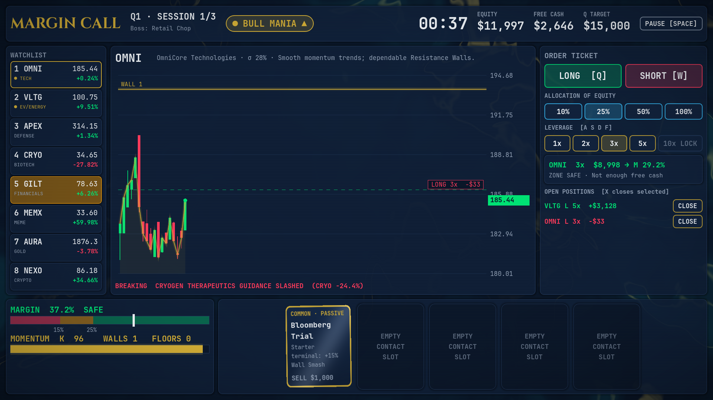
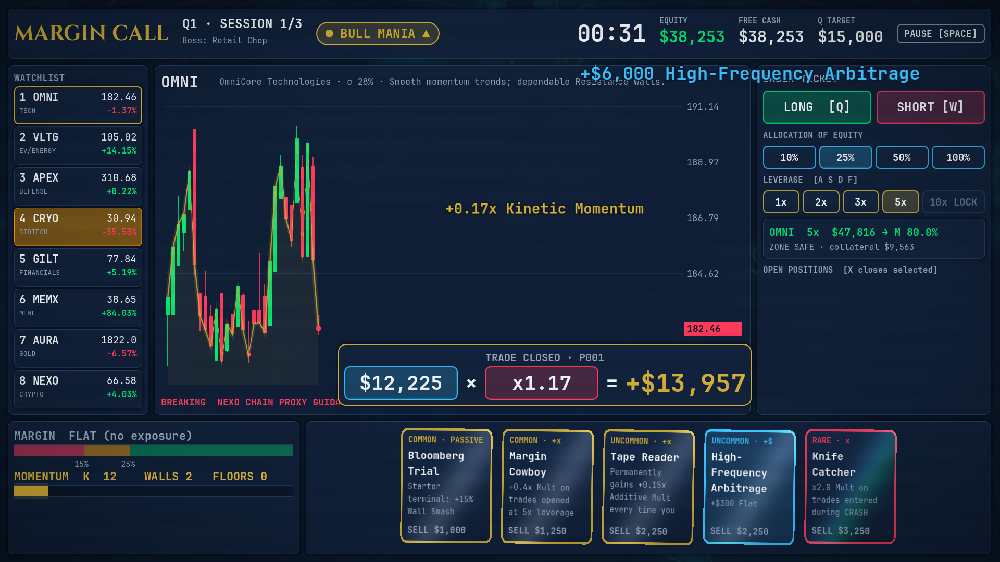
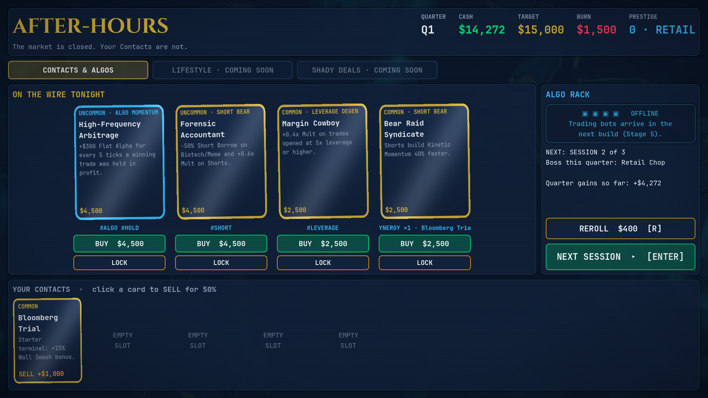
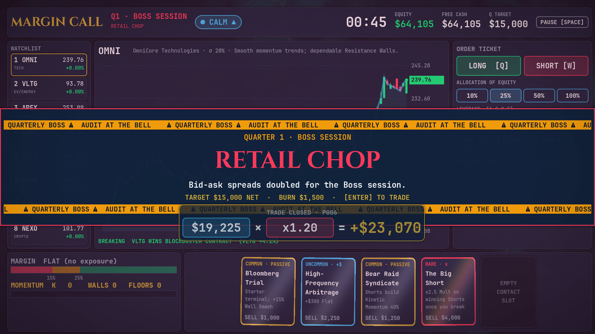
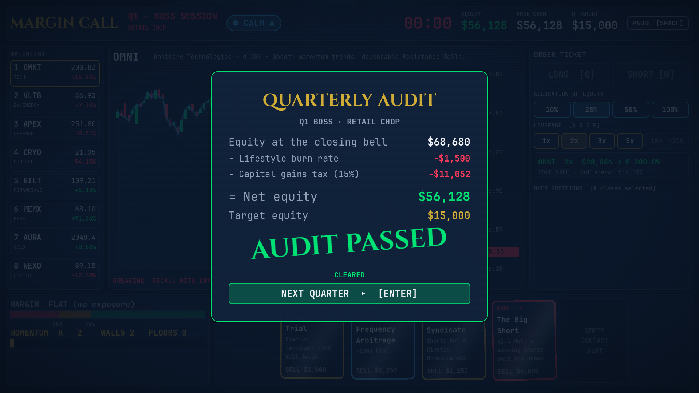
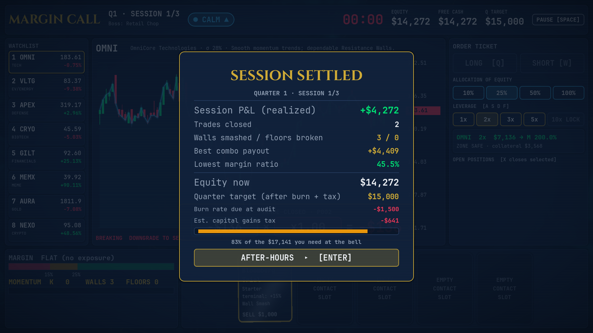
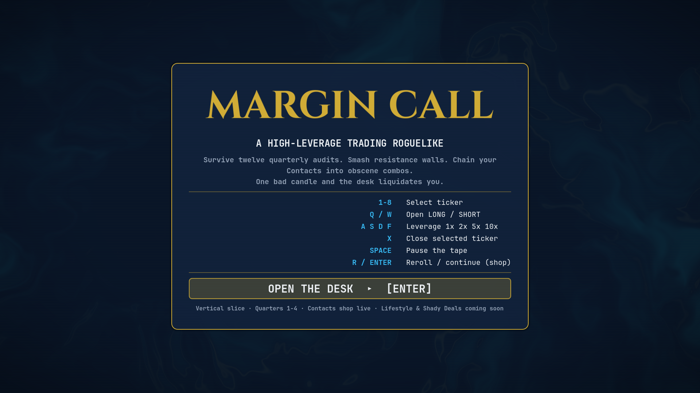

<div align="center">

# MARGIN CALL

**A high-leverage trading roguelike.** Survive quarterly audits, smash resistance walls and chain your Contacts into combos. One bad candle and the desk liquidates you.

[**▶ Play in your browser**](https://yasskik.github.io/margin-call/) · [Windows build](#download) · [How to play](#how-to-play) · [Build from source](#build--test)


-d4af37)



</div>

## Overview

Margin Call is *Balatro* meets a Bloomberg terminal. Every **session** is a 45-second burst of live, simulated market action. You go long or short on eight tickers with up to 10x leverage while a margin gauge tells you exactly how close you are to liquidation.

When you close a trade, your **Contacts** fire in strict order (base alpha → flat alpha → additive mult → compound xMult), and the payout plays out as a fast combo on screen.

There are three sessions per **quarter**. Then a **Quarterly Boss** changes the rules (doubled spreads, a CPI shock, a short-sale ban, a tax hike…). After the boss comes the **audit**: pay your lifestyle burn and capital-gains tax, then clear the equity target or you're out.

This repository holds the **vertical slice** (blueprint Stages 0–4A). The full Quarter 1 → Quarter 4 loop is playable, and the Contacts shop is live.

| | |
|:--:|:--:|
|  **Combo pipeline**: Contacts pop in order and the payout ticks up |  **After-Hours shop**: buy, sell for 50%, lock and reroll Contacts |
|  **Quarterly Boss** banner: the boss session's rules |  **Audit**: equity − burn − tax vs the target |
|  **Session settlement** receipt |  **Title screen** with the controls |

## Features

- **A real market model, sped up.** Prices follow regime-switching geometric Brownian motion (Calm / Bull Mania / Volatile / Crash) with Merton jump diffusion, bid-ask spreads, betas, short-borrow fees and dividends. All of it is compressed into 450-tick sessions.
- **Honest margin.** The margin ratio is M = Equity / Gross exposure. Below 25% you're in the warning zone, and below 15% the desk force-liquidates you with 2% slippage. Before every entry, a live preview shows the margin you'd have afterwards and which zone it lands in.
- **Readable signals.** A regime chip, jump warnings (1.5 s ahead), and a momentum meter with a resistance-wall ladder. Skill comes from reading the tape, not from luck.
- **Resistance walls (Burrito Bison style).** Break through price walls at 2x leverage or more to bank wall bonuses and build kinetic momentum.
- **4-phase modifier pipeline (Balatro style).** `(Base + ΣFlat) × (1 + ΣAdd) × ΠX`, resolved strictly left to right, with loss protection. Each step is played back by an accelerating combo sequencer that pops the card responsible.
- **18 launch Contacts across 4 archetypes:** Leverage Degen, Short Bear, Insider Heat and Algo/Momentum. Effects are data-driven from JSON.
- **The quarter loop.** 3 sessions → Boss → audit. Burn rate, 15% capital-gains tax, Prestige tiers that improve shop rarity odds, and 10x leverage that unlocks at Prestige 25.
- **After-Hours shop (Brotato style).** Four offers, an escalating reroll cost, locks that carry over between visits, 50% sellback and synergy tags.
- **12 data-complete Quarterly Bosses.** Q1–Q4 make up the tuned slice; the later quarters are playable but not yet balanced.
- **Liquid-glass presentation.** Animated shader backdrop, mouse-tilted foil cards, CRT/bloom overlay, hit-stop, screen shake, and a palette driven by `ThemeTokens`.
- **Deterministic and testable.** The whole simulation lives in a headless `RefCounted` layer with an injected seeded RNG. The same seed always produces the same run.

## How to play

| Key | Action |
|:--|:--|
| `1`–`8` | Select a ticker |
| `Q` / `W` | Open a **LONG** / **SHORT** on the selected ticker |
| `A` `S` `D` `F` | Leverage 1x / 2x / 5x / 10x (3x via the pill) |
| Allocation pills | Commit 10 / 25 / 50 / 100% of equity |
| `X` | Close the position on the selected ticker |
| `SPACE` | Pause the tape |
| `ENTER` | Continue (settlement, audit, shop → next session) |
| `R` | Reroll the shop |

**Tips**
- Watch the regime chip. Bull Mania favours longs on high-beta names; in a Crash, short or get out.
- Use 2x leverage or more to light up the wall ladder. Every wall you smash adds a bonus and momentum to the trade.
- Keep an eye on the margin gauge. Opening more leveraged trades while you're in the warning zone is locked.
- The audit deducts burn and tax **before** checking your net against the target, so plan for both.

## Download

- **Web:** <https://yasskik.github.io/margin-call/> (single-threaded build, so it works on GitHub Pages without SharedArrayBuffer headers)
- **Windows x86_64:** download `MarginCall-windows-x86_64.zip` from the [Releases](https://github.com/Yasskik/margin-call/releases) page, unzip it and run `MarginCall.exe`. The build is unsigned, so SmartScreen may ask you to confirm.

## Tech stack

- **Godot 4.7.2** (standard build), with the **GL Compatibility** renderer on every platform so it runs on older PCs and in the browser
- **Typed GDScript** with a hard cap of 300 lines per file
- **Headless sim layer** (`src/sim`, `src/models`). Pure `RefCounted` classes with no nodes, no autoloads and an injected `RNGService`
- **Typed `EventBus`** and an `EventBridge` that forwards sim signals to the UI
- **JSON registries** (`data/`) for stocks, Contacts, bosses, algos, lifestyle, shady deals, backgrounds and all simulation constants
- **Code-first UI** (`src/ui`) with custom shaders (`src/shaders`): liquid backdrop, card tilt/foil and CRT bloom
- Fonts: **JetBrains Mono** and **Cinzel** (SIL Open Font License, see `assets/fonts/`)

```
src/
  autoload/   ThemeTokens, EventBus, DataRegistry, AudioDirector*, SaveManager*   (*stubs)
  models/     StockDef, PerkDef, AlgoDef, PositionState, TriggerStep, PerkInstance
  sim/        MarketEngine, JumpScheduler, PortfolioState, MomentumEngine, ModifierPipeline,
              SessionRunner/RunSession, RunController (quarter FSM), ShopGenerator, QuarterRules, LifeSimState
  ui/         RootShell, ScreenRouter, MainTerminal (+ chart, tickers, trade panel, gauges, tray),
              JuicyCard, ComboSequencer, screens/ (title, shop, boss banner, settlement, audit, receipt)
  shaders/    liquid_terminal_bg, card_tilt_foil, crt_bloom_overlay
data/         *.json registries
tests/        headless test runner + suites
```

## Build & test

You need Godot 4.7.x (standard) on your `PATH` as `godot`, plus the matching export templates.

```bash
# full verification gate: import, parse check, headless tests, modularity audit
bash scripts/verify.sh

# tests only (exit code 0 means everything passed)
godot --headless --import
godot --headless -s tests/test_runner.gd

# exports: builds/web/index.html (single-threaded) and builds/windows/MarginCall.exe, then zip
bash scripts/build_all.sh

# run the game
godot --path .
```

The test suites cover:
- identical seeds producing identical paths
- exact 5x long/short P&L
- margin warning and liquidation
- wall-smash tiers
- the time-scale statistics of the GBM
- the entry-sizing table
- jump warnings
- regime transition rows
- the exact 4-phase ordering and loss protection
- every launch perk's condition
- deterministic Q1→Q4 progression
- tax and burn math
- insolvency
- the reroll cost curve
- locks and 50% sellback
- boss modifiers

**Dev autopilot.** This is for screenshots and smoke tests only. `godot -- --autopilot=flow --seed=1` plays the whole 12-quarter loop through the real UI. Other scenarios are `terminal`, `combo`, `shop`, `slice`, `bust` and `menu`. Add `--shotdir=/abs/dir` to save PNGs.

## Roadmap

- **Stage 4B:** stress, sleep and SEC heat; the Lifestyle and Shady Deals tabs; the life-sim Contacts
- **Stage 5:** the Algo Rack with the 6 trading bots
- **Stages 6–10:** audio (4-stem adaptive music), save/meta progression, a balancing harness (500 bot runs), polish and the Steam/itch export pipeline

---

© 2026 Yamen Agha. All rights reserved. The fonts are licensed under the SIL Open Font License 1.1.
